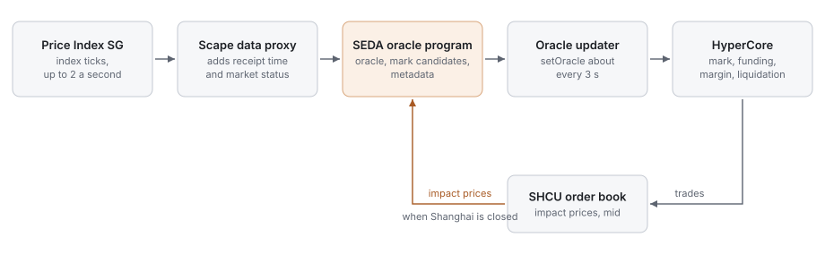
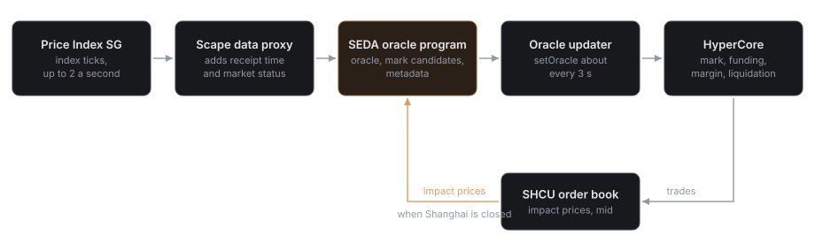

## Who does what

| Layer | Party | Role |
| --- | --- | --- |
| Benchmark | Price Index SG | Administers and publishes the China Copper Spot Index (SGPI-CA-INDEX). Sole control over methodology, determination and corrections |
| Origination | Scape (Seneca Research, Inc.) | Designs the contracts, holds the benchmark license, specifies the oracle methodology and risk framework, runs the liquidity program, publishes this documentation |
| Oracle computation | SEDA | Runs the SHCU oracle program and returns signed results with freshness metadata |
| Perpetual deployer | Entropy (Bursa Global Inc.) | Operates the `io` HIP-3 dex and lists `io:SHCU`. Carries the deployer stake, submits oracle updates, sets onchain risk parameters, monitors the market around the clock |
| Outcome deployer | Skew (Skew Technologies, Inc.) | Deploys and settles the SHCU outcome markets under HIP-4. Runs a matching service that routes maker quotes and user orders to HyperCore's outcome books |
| Venue | Hyperliquid (HyperCore) | Matching, margining, funding, liquidation and settlement. Holds USDC collateral in each trader's own account |

<Note>
  Scape does not custody funds, does not match orders and is not a counterparty to any trade.
</Note>

## Deployment

| | Perpetual | Outcome markets |
| --- | --- | --- |
| Hyperliquid framework | HIP-3 | HIP-4 |
| Deployer | Entropy | Skew |
| Dex or venue | `io` | Returned by `outcomeMeta` |
| Market | `io:SHCU` | SHCU Monthly Touch, SHCU Quarterly Close |
| Deployer address | `0xd5d18d5f4026a33ca6c8fce75551b24cbb5452ea` | Returned by `outcomeMeta` |
| Oracle updater address | `0x94757f8dCB4Bf73b850195660E959D1105CFeDd5` | Not applicable. Outcomes are settled by deployer action |
| Oracle computation | SEDA oracle program | The same oracle, read at resolution |
| Fee setting | Growth Mode on, deployer fee scale 1.0 | `deployerFeeScale` 0.5 |

Addresses are as published by Entropy for the `io` dex. `perpDexs` returns the values in force.

## How a price reaches the order book

<Frame caption="An index print reaches HyperCore in four hops. When Shanghai is closed, the oracle program also reads impact prices from the SHCU book.">
  
  
</Frame>

1. **Index.** Price Index SG publishes the index during Shanghai sessions at up to two ticks per second.
2. **Proxy.** The data proxy attaches the source timestamp, its own receipt timestamp and the market status (`active`, `closed` or `holiday`). Receipt time is authoritative for freshness.
3. **Oracle program.** A deterministic program selects the regime and computes the oracle price and two mark-price candidates. Its only memory is its own previous result. During closed sessions it also reads the SHCU book's impact prices from HyperCore.
4. **Submission.** The deployer's oracle updater submits the result to HyperCore about every 3 seconds. HyperCore accepts oracle updates no more often than every 2.5 seconds.
5. **Venue.** HyperCore composes the final mark price as a median that includes its own local book price, then runs funding, margin checks and liquidations.

The methodology for steps 2 to 4 is in [Oracle](/oracle) and [Mark price](/mark-price).

## What each party can and cannot do

| Party | Can | Cannot |
| --- | --- | --- |
| Price Index SG | Determine, correct, suspend or change the index under its methodology | See or act on SHCU positions. It has no role in operating the market |
| Scape | Specify the methodology, the contract and the liquidity program | Direct an index determination, see an index value before its release, hold or move user funds |
| Deployer | Submit oracle updates, set leverage, margin tables, open interest caps and fee settings, halt trading | Move the mark by more than 1% per update, hold or move user funds, change settled trades |
| Hyperliquid validators | Enforce protocol rules. Slash a deployer's stake by stake-weighted vote for invalid or irregular operation | — |

Halting a HIP-3 market cancels all open orders and settles all positions at the current mark price. See [Operations and change control](/operations-and-change-control).

## What is verifiable onchain

Every production parameter in this documentation can be read from Hyperliquid's public API or from the oracle feed.

| Item | Where |
| --- | --- |
| Contract metadata: size decimals, max leverage, margin table, margin mode | `meta` for dex `io` |
| Oracle price, mark price, premium, funding rate, open interest, impact prices | `metaAndAssetCtxs` for dex `io` |
| Open interest cap, funding multiplier, deployer and oracle updater addresses | `perpDexs`, `perpDexLimits` |
| Order book and trades | `l2Book`, WebSocket `trades` |
| Funding history | `fundingHistory` |
| Session state, anchor, band, clamp, re-anchors used, index age | Oracle feed metadata, published with every update |
| Outcome definitions, strikes, expiries, fee scale, settlement values | `outcomeMeta` |

Request shapes are in [API integration](/api-integration).

## Deployer stake

A HIP-3 deployer stakes 500,000 HYPE to operate a dex, and a HIP-4 deployer stakes 500,000 HYPE to deploy outcome markets. Validators can slash that stake for invalid inputs, irregular operation or incorrect settlement. Slashed stake is burned. It is a penalty on the operator and is not a fund that compensates traders.

## Independence

Price Index SG, SEDA, Entropy, Skew and Hyperliquid are independent of Scape and of each other. None of them sponsors, endorses or guarantees SHCU. Their roles are limited to those described on this page.
