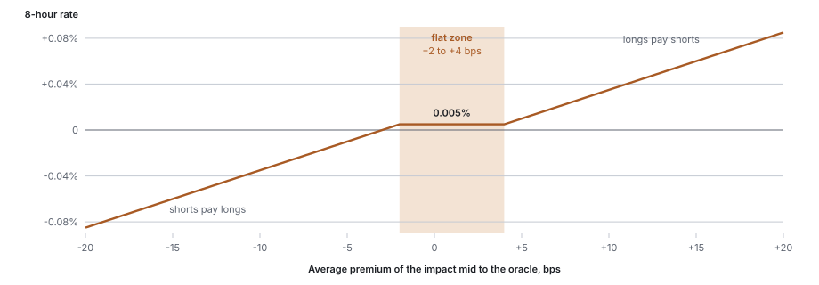
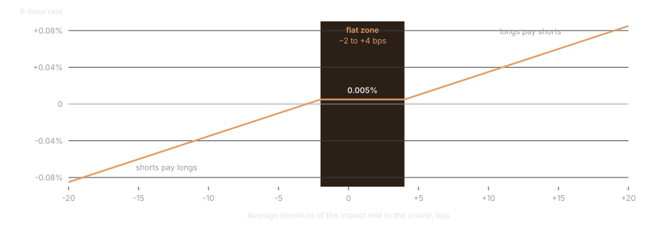

## Parameters

| Parameter | Value |
| --- | --- |
| Funding interval | 1 hour |
| Funding multiplier `m` | 0.5 |
| Interest rate `r` | 0.01% per 8 hours |
| Premium clamp `c` | 0.03% per 8 hours, the HyperCore default for builder-deployed perpetuals |
| Premium sampling | Every 5 seconds, averaged over the hour |
| Hourly cap | 0.5%, set by the protocol |

## Calculation

**Premium.** Every 5 seconds HyperCore samples the premium of the book to the oracle. For builder-deployed perpetuals it is measured from the impact mid:

```text
premium = (impact bid + impact ask) ÷ 2 ÷ O − 1
```

The premium is the distance of the impact mid from the oracle. It is positive when the book sits above the oracle and negative when it sits below, and it responds to a displacement of any size, including one inside the bid–ask spread. `P` is the average of these samples over the hour.

**Rate.** The 8-hour rate is the premium, pulled toward the interest rate by at most the clamp, scaled by the multiplier:

```text
F_8h = m × [ P + clamp(r − P, −c, +c) ]
```

**Payment.** One eighth of the 8-hour rate is paid each hour on oracle-valued notional:

```text
payment (USDC) = size × O × F_8h ÷ 8
```

A positive rate is paid by longs to shorts. A negative rate is paid by shorts to longs.

## Reading the formula

<Frame caption="The 8-hour rate against the hourly average premium, at a 0.5 multiplier and a 0.03% clamp.">
  
  
</Frame>

**Inside the clamp, funding is a constant.** When the average premium is within `c` of `r`, the bracket equals `r` and the rate is `m × r`. That zone runs from 2 bps below the oracle to 4 bps above it, which is −22 to +44 CNY/t at 110,000.

| | |
| --- | --- |
| 8-hour rate | 0.5 × 0.01% = 0.005% |
| Hourly rate | 0.000625% |
| Annualized | about 5.5%, paid by longs |

Premium noise inside that zone does not move funding. This is the normal in-session state of a book quoted around the index.

**Outside the clamp, funding scales with the premium.** When the book sits above the oracle by more than 4 bps on average, the rate is `m × (P − c)`. When it sits more than 2 bps below, the rate is `m × (P + c)`. The 0.5 multiplier halves the standard response, which fits a contract whose reference is closed for most of the week.

| Average premium over the hour | 8-hour rate | Hourly rate |
| --- | --- | --- |
| −2 to +4 bps | 0.005% | 0.000625% |
| +10 bps | 0.035% | 0.004375% |
| +50 bps | 0.235% | 0.029375% |
| −50 bps | −0.235% | −0.029375% |

## Funding by session state

| State | What funding does |
| --- | --- |
| Active | The oracle is the index. Funding ties the book to the live Shanghai price |
| Closed and holiday | The oracle is discovered from the book with a 30-minute time constant. A premium opens when the book moves and decays as the oracle follows, so off-hours funding is self-limiting |
| Reopen | The oracle steps to the first fresh index print. Any distance the book has not yet covered appears as premium, and funding acts on it from the next sample |

The practical point for carry: a position held across a closure pays or receives funding on the difference between where the book trades and where the bounded oracle has reached, not on the unobservable Shanghai price.

The off-hours oracle target and the funding premium are the same quantity. Both are measured from the impact mid, so the oracle moves toward exactly the price that funding is charging for, and the premium decays with the oracle's 20.8-minute half-life once the book stops moving.

## Example

A long of 20 contracts with the oracle at 110,000:

```text
notional = 20 × 110,000 = 2,200,000 USDC

premium inside the clamp
  hourly  = 2,200,000 × 0.000625% = 13.75 USDC paid
  per day = 330 USDC

premium averaging +50 bps for an hour
  hourly  = 2,200,000 × 0.029375% = 646.25 USDC paid
```

The parameters in force and the realized hourly rates are readable from Hyperliquid's API. See [API integration](/api-integration).
