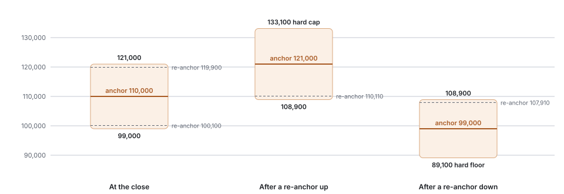
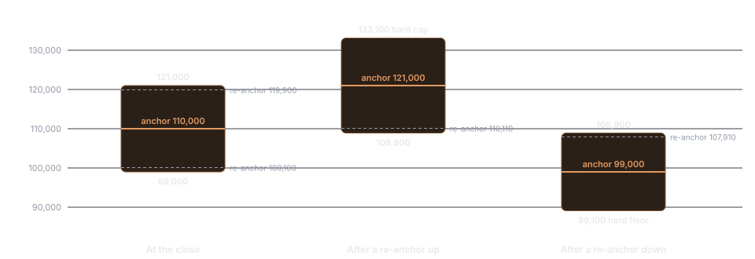

## Invariants

In every regime, the oracle program applies none of the following:

- USD/CNY or any other FX conversion
- Tonne-to-pound or any other unit conversion
- A fixed scaling factor
- Normalization to a COMEX or LME price level
- Smoothing of fresh active-session data

<Info>
  During Shanghai hours the SHCU oracle equals the index tick for tick. Outside them, its level is set only by trading in SHCU.
</Info>

## Parameters

| Parameter | Value |
| --- | --- |
| Index sessions (UTC+8) | 09:00–10:15, 10:30–11:30, 13:30–15:00, 21:00–01:00 |
| Oracle submission | About every 3 seconds |
| Freshness threshold | 5 seconds |
| Stale hold | 60 seconds |
| Off-hours target | SHCU book impact mid |
| EMA time constant | 30 minutes |
| Per-update clamp | 50 bps |
| Discovery band | ±1,000 bps around the anchor |
| Re-anchor threshold | 90% of the band |
| Re-anchors | 1 per direction per closure |
| Holiday band | ±1,000 bps, 0 re-anchors |
| External reference price | Last index print |

## Session states

Each update is published with one of four states.

| State | Condition | Oracle |
| --- | --- | --- |
| `active` | Session open and the index print is no more than 5 seconds old | Index print, unmodified |
| `stale` | Session open by calendar, index print older than 5 seconds | Last valid value held for up to 60 seconds, then bounded discovery |
| `closed` | Intraday break, lunch, evening gap, overnight gap, weekend | Bounded discovery |
| `holiday` | Mainland China statutory holiday closure | Bounded discovery with no re-anchor |

Session state comes from the market status reported with each index print, cross-checked against print freshness. The intraday break and lunch are short closures and use the same machinery as a weekend. They are not special-cased.

## Active session: passthrough

```text
O(t) = Index(t)
```

The oracle is the index print in CNY per tonne. Nothing else is applied.

## Stale feed

If the calendar says the session is open but the index stops updating, the oracle does not continue as if fresh.

| Index age | Behavior |
| --- | --- |
| Up to 5 seconds | `active`. Passthrough |
| 5 to 60 seconds | `stale`. The last valid oracle is held and a stale-streak counter advances |
| Beyond 60 seconds | Bounded discovery, as in a closed session, until fresh prints resume |

A fresh print resets the counter and returns the oracle to passthrough.

## Closed session: bounded discovery

When Shanghai is closed there is no local price to pass through. The market keeps trading, and the oracle follows it under four constraints.

**1. Anchor.** At the active-to-closed transition the anchor `A` is set to the last valid active-session oracle value.

**2. Target.** The discovery input is the impact mid of the SHCU order book on HyperCore:

```text
P_venue(t) = (impact bid + impact ask) ÷ 2
```

Impact prices are the average fill prices for a fixed notional on each side of the book, so a small order at the top of the book does not set the target.

**3. Continuous-time EMA.** The oracle moves from its previous value toward the target, weighted by elapsed time:

```text
α      = 1 − exp(−Δt ÷ T)          T = 30 minutes
O_raw  = O_prev + α × (P_venue − O_prev)
```

**4. Bounds.** After the EMA step:

```text
Per update:   O stays within O_prev × (1 ± 0.005)
Cumulative:   O stays within A × (1 ± 0.10)
```

**Re-anchor.** A sustained move is allowed to continue once. When the oracle reaches 90% of the distance from the anchor to a band edge, the anchor moves to that edge and one re-anchor is consumed for that direction. At most one re-anchor is applied per update. When a direction's re-anchor has been used, the band edge is a hard cap and the feed reports `bound = true`. Re-anchor counters clear when active-session pricing resumes.

### Band levels

With the last index print at 110,000 CNY/t:

<Frame caption="One re-anchor per direction moves the band once. The furthest the oracle can finish is 133,100 or 89,100.">
  
  
</Frame>

| State of the closure | Anchor | Lower edge | Upper edge | Re-anchors down at | Re-anchors up at |
| --- | --- | --- | --- | --- | --- |
| At the close | 110,000 | 99,000 | 121,000 | 100,100 | 119,900 |
| After a re-anchor up | 121,000 | 108,900 | 133,100 | 110,110 | Used. 133,100 is a hard cap |
| After a re-anchor down | 99,000 | 89,100 | 108,900 | Used. 89,100 is a hard floor | 107,910 |
| Holiday closure | 110,000 | 99,000 | 121,000 | None. Both edges are hard | None. Both edges are hard |

The trigger is 90% of the way from the anchor to an edge, which is 9% from the anchor. The furthest the oracle can finish from the last index print is 133,100 on the upside and 89,100 on the downside.

### What the parameters imply

| Quantity | Value |
| --- | --- |
| Half-life of the gap between oracle and book | 20.8 minutes |
| Share of a persistent gap closed after 1 hour | 86% |
| Share of the remaining gap closed per 3-second update | 0.17% |
| Time to move the oracle 1% with the impact mid held 2% from the oracle's starting level | 20.8 minutes |
| Time to move the oracle 1% with the impact mid held 5% from the oracle's starting level | 6.7 minutes |
| Maximum oracle travel in one ordinary closure | +21.0% / −19.0% |
| Maximum oracle travel in one holiday closure | ±10.0% |

The band is ±1,000 bps because that is 1 ÷ maximum leverage: without a re-anchor, the oracle cannot travel further in one closure than the full initial margin of a 10× position. With one re-anchor the limits compound to 1.10 × 1.10 and 0.90 × 0.90.

At a 3-second cadence the per-update clamp does not bind. It exists for the case where updates are spaced far apart and a single EMA step would otherwise be large.

### Thin book

If the SHCU book cannot fill the impact notional on a side, there is no impact price and no target. Discovery pauses and the oracle holds its last value until impact prices are available again.

### Holidays

Chinese national holidays can close the Shanghai market for a week or more. Dates are in [Trading calendar](/trading-calendar). The same discovery process runs, with the ±1,000 bps band as a hard cap for the whole closure and no re-anchor.

## Reopen

The first fresh index print after a closure passes straight through. The oracle steps from its discovered value to the index, and the anchor and re-anchor counters reset. HyperCore limits each mark-price update to 1% from the previous mark, so the mark follows a large step over several updates. The order book converges by trading and funding.

A reopen gap is the move from the last index print before a closure to the first print after it. It is the distance the oracle has to travel if the book does nothing during the closure.

| Closure | Count | Median (bps) | 5th pct | 95th pct | Largest | Largest as share of band |
| --- | --- | --- | --- | --- | --- | --- |
| Morning break | 240 | +0.0 | −11 | +8 | 64 | 6% |
| Lunch | 240 | −1.0 | −29 | +23 | 87 | 9% |
| Evening gap | 222 | +0.7 | −80 | +90 | 330 | 33% |
| Overnight gap | 188 | +1.0 | −36 | +58 | 132 | 13% |
| Weekend | 48 | +7.7 | −88 | +64 | 237 | 24% |
| Holiday | 6 | +35.2 | −152 | +244 | 274 | 27% |

Sample: 1 September 2025 to 18 September 2026. Every scheduled reopen fell inside the band, the largest using one third of it.

## Published metadata

The oracle is transparent about its own state. A constant oracle during a closure is acceptable. An opaque one is not. Every update carries:

| Field | Meaning |
| --- | --- |
| `oraclePx` | Oracle price, CNY per tonne |
| `markPxs` | The two mark candidates submitted to HyperCore: the oracle, and the oracle plus the basis EWMA |
| `extPerpPx` | Last index print. Equals `oraclePx` in passthrough and stays at the last print during a closure |
| `session` | `active`, `stale`, `closed` or `holiday` |
| `emaActive` | Whether bounded discovery is running |
| `source.lastIndexPx`, `source.lastIndexTs` | Last index print and its source timestamp |
| `source.ageMs`, `source.fresh` | Age of that print by receipt time, and whether it is inside the freshness threshold |
| `staleStreak` | Consecutive stale updates |
| `basisEwma` | 150-second EWMA of (perp mid − oracle) |
| `discovery.anchor` | Reference for the band in force |
| `discovery.perUpdateBps`, `discovery.cumulativeBandBps` | Clamp and band in force |
| `discovery.resetsUp`, `discovery.resetsDown`, `discovery.maxResetsUp`, `discovery.maxResetsDown` | Re-anchors used and allowed |
| `discovery.bound` | `true` when the oracle is pinned at a hard band edge |

Example during an evening gap:

```json
{
  "symbol": "SHCU",
  "oraclePx": "110412.000000",
  "markPxs": ["110412.000000", "110431.000000"],
  "extPerpPx": "110380.000000",
  "session": "closed",
  "emaActive": true,
  "source": {
    "provider": "Price Index SG",
    "lastIndexPx": "110380.000000",
    "lastIndexTs": "2026-11-11T07:00:00Z",
    "ageMs": 5412000,
    "fresh": false
  },
  "staleStreak": 0,
  "timestamp": "2026-11-11T08:30:12Z",
  "sedaTimestamp": "2026-11-11T08:30:13.412Z",
  "basisEwma": "19.000000",
  "discovery": {
    "anchor": "110380.000000",
    "perUpdateBps": "50",
    "cumulativeBandBps": "1000",
    "bound": false,
    "resetsUp": 0,
    "resetsDown": 0,
    "maxResetsUp": 1,
    "maxResetsDown": 1
  }
}
```

Any consumer can verify from this record that an off-hours price stayed inside the band in force.

## State and determinism

The oracle program is stateless between runs. Its previous result carries everything that persists: the anchor, the EMA value, clamp and band accounting, re-anchor counters, the basis EWMA, the session state and the stale-streak counter. Each output is a deterministic function of the current inputs and the previous result. On a cold start during a closure, the oracle seeds at the last known index value, or at the first impact mid if none is known.

All time constants, clamps, bands and re-anchor limits are execution inputs to the program. They are changed by configuration under [Operations and change control](/operations-and-change-control), not by redeploying code.

## What off-hours values are

<Note>
  Closed-session and stale-fallback oracle values are calculated by the oracle program from SHCU's own market. They are not index values, not assessments by Price Index SG and not approved by Price Index SG.
</Note>
