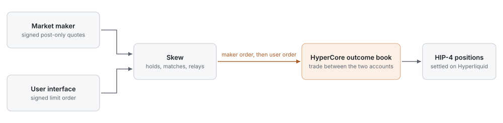
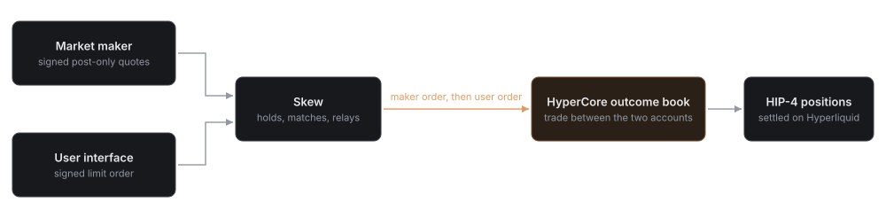

Either way the trade is a HyperCore trade between two Hyperliquid accounts, and the position is an ordinary HIP-4 position.

## Two routes to one book

| | Direct | Through Skew |
| --- | --- | --- |
| Used by | Any account, through any Hyperliquid interface or API client | Users of interfaces integrated with Skew, and market makers connected to it |
| Liquidity reached | Orders resting on the public book | The public book, plus maker quotes held by Skew |
| Where the trade happens | HyperCore outcome book | HyperCore outcome book |
| Custody | The trader's own Hyperliquid account | The trader's own Hyperliquid account. Nothing is deposited with Skew |
| Fees | Hyperliquid outcome fees | The same. No Skew fee and no builder code is added to the order |
| Settlement | HIP-4, by the deployer under the template | The same |

## How Skew matching works

<Frame caption="Skew holds signed orders and relays them. The trade itself happens on HyperCore, between the two accounts.">
  
  
</Frame>

1. **Makers quote.** A market maker signs ordinary Hyperliquid post-only orders and hands them to Skew unsent, each with a pre-signed cancel.
2. **Users order.** A user's interface signs an ordinary Hyperliquid limit order with an API wallet the user has approved, and hands it to Skew.
3. **Skew matches.** When maker quotes can fill the user's order at its limit or better, Skew sends the makers' orders to HyperCore and then the user's order. They trade on the public book.
4. **Remainders.** What a maker's order leaves is cancelled. What the user's order leaves rests on the public book in the user's account until the deadline the user set.

<Note>
  The user's order is sent whether or not a maker quote is available.
</Note>

## Properties

| Property | Detail |
| --- | --- |
| Non-custodial | USDC and shares stay in each party's own Hyperliquid account. A quote reserves nothing until it is sent |
| No keys and no edits | Skew relays each order exactly as it was signed. It cannot change a price, a size or a side |
| Firm quotes | A maker quote is binding until it expires, is replaced or is withdrawn. There is no last look |
| Short-lived quotes | Quotes expire quickly and are refreshed continuously. A maker can withdraw one market or every market in a single call |
| Price improvement | A trade prints at the resting order's price. A user whose limit is better than the maker's quote keeps the difference |
| Public book | A maker's order is on the public book for a moment while a match completes. Any account can trade against it at that price |
| Fills | Ordinary Hyperliquid fills on each account, reported in the same feeds as any other fill |

## Quoting both sides with USDC

Yes and No trade on one merged book. A bid for Yes at `p` and an offer of No at `1 − p` are the same order. A maker therefore makes a two-sided market from a USDC balance alone: the bid is a buy of Yes, and the offer is a buy of No at the complement. When a buy of Yes meets a buy of No, the pair is minted and each side receives its shares.

| Example: 400 shares, maker offers Yes at 0.452 | |
| --- | --- |
| Maker's quote | Post-only buy of 400 No at 0.548 |
| User's order | Buy 400 Yes, limit 0.455 |
| Trade price | 0.452 for Yes. The user's limit was better, so the user keeps 0.003 a share |
| User pays | 180.80 USDC |
| Maker pays | 219.20 USDC |
| Minted | 400 Yes to the user, 400 No to the maker, backed by 400 USDC |
| Fee to open | None, on either side |
| If Yes wins | The user's 400 shares settle to 400 USDC |
| If No wins | The maker's 400 shares settle to 400 USDC |

## For market makers

| The desk needs | Why |
| --- | --- |
| A Hyperliquid account holding USDC, or shares to sell | A quote is backed from the account's free balance at the moment it is sent |
| A dedicated API wallet for quoting | It keeps the quoting key's nonces apart from the desk's other Hyperliquid activity |
| A loop that signs, refreshes and withdraws quotes | Quotes are standard Hyperliquid order actions, signed offline |
| Fill handling on Hyperliquid's own feeds | Fills arrive as normal fills on the account, and hedges key off them |
| Access from Skew | Skew issues maker credentials, allow-lists quoting accounts, sets per-maker limits and provides the integration specification |

Market makers also quote SHCU outcomes by resting orders directly on the HyperCore book, with no integration beyond Hyperliquid's API.

## For interfaces

An interface offers Skew matching through Skew's client library. The interface signs each order with an API wallet that the user has approved on Hyperliquid, and it shows the order's state from Skew's order feed. Access is granted by Skew, which registers each integrating interface.

## Limits

Skew sets order-size and open-order limits for users and quoting limits for each maker, and returns them through its API. An order above those limits trades directly on the HyperCore book.

## If Skew is unavailable

The outcome books do not depend on Skew. Orders can be placed and cancelled directly on HyperCore at any time. An order that Skew routed is an ordinary order of the account that placed it, and that account can always cancel it on Hyperliquid.

## Pricing inputs

SHCU outcomes resolve on the SHCU oracle. The inputs a desk needs to price and hedge them are the oracle and its session state, the `io:SHCU` book, and the strike and expiry of each outcome. All are public. See [Oracle](/oracle), [Outcome markets](/outcome-markets) and [API integration](/api-integration).
