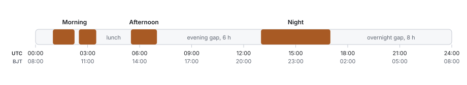
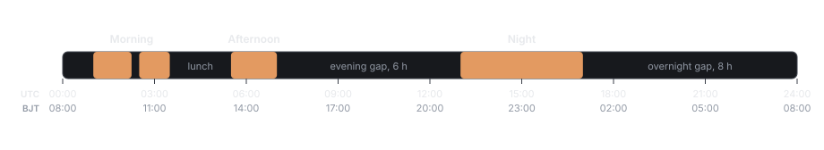

## Index sessions

| Session | Beijing time (UTC+8) | UTC |
| --- | --- | --- |
| Morning 1 | 09:00 – 10:15 | 01:00 – 02:15 |
| Morning 2 | 10:30 – 11:30 | 02:30 – 03:30 |
| Afternoon | 13:30 – 15:00 | 05:30 – 07:00 |
| Night | 21:00 – 01:00 (next day) | 13:00 – 17:00 |

<Frame caption="Index sessions in UTC, with Beijing time beneath. Filled blocks are the 7.75 hours a day the index publishes.">
  
  
</Frame>

Sessions run Monday to Friday. Friday's night session ends at 01:00 on Saturday, Beijing time. China does not observe daylight saving time, so the UTC times hold all year.

## Closures in a normal week

| Closure | From | To | Length | Per week |
| --- | --- | --- | --- | --- |
| Morning break | 10:15 | 10:30 | 15 minutes | 5 |
| Lunch | 11:30 | 13:30 | 2 hours | 5 |
| Evening gap | 15:00 | 21:00 | 6 hours | 5 |
| Overnight gap | 01:00 | 09:00 | 8 hours | 4 |
| Weekend | Saturday 01:00 | Monday 09:00 | 56 hours | 1 |

Times are Beijing time. The index publishes for 38.75 of the week's 168 hours. In every closure the oracle runs bounded discovery in the `closed` state. See [Oracle](/oracle).

## 2027 holiday closures

| Holiday | Statutory dates | Last index print | First index print | Closure |
| --- | --- | --- | --- | --- |
| New Year | 1 – 3 January | Thu 31 Dec 2026, 15:00 | Mon 4 Jan, 09:00 | 3.75 days |
| Spring Festival | 5 – 13 February | Thu 4 Feb, 15:00 | Mon 15 Feb, 09:00 | 10.75 days |
| Qingming | 3 – 5 April | Fri 2 Apr, 15:00 | Tue 6 Apr, 09:00 | 3.75 days |
| Labour Day | 1 – 5 May | Fri 30 Apr, 15:00 | Thu 6 May, 09:00 | 5.75 days |
| Dragon Boat | 9 June | Tue 8 Jun, 15:00 | Thu 10 Jun, 09:00 | 1.75 days |
| Mid-Autumn | 15 September | Tue 14 Sep, 15:00 | Thu 16 Sep, 09:00 | 1.75 days |
| National Day | 1 – 7 October | Thu 30 Sep, 15:00 | Fri 8 Oct, 09:00 | 7.75 days |

Times are Beijing time. 15:00 is 07:00 UTC and 09:00 is 01:00 UTC.

Three rules produce the closure times:

- **No night session before a holiday.** The last print is the 15:00 close of the last trading day before the holiday.
- **Make-up working days are not trading days.** Sunday 31 January, Sunday 14 February, Saturday 8 May, Sunday 26 September and Saturday 9 October 2027 are working days in mainland China. The futures market stays closed on them.
- **Trading resumes with the day session.** The first print after a holiday is at 09:00.

<Info>
  Statutory dates are from the State Council's notice on the 2027 holiday schedule, published on 5 November 2026. The Chinese futures exchanges confirm each closure by notice, and those notices take precedence over this table.
</Info>

### The oracle during a holiday

The feed's market status sets the session state. During a statutory holiday closure it reports `holiday`, and the oracle applies the holiday band: ±1,000 bps around the last index print, with no re-anchor. The SHCU book, the mark price, funding and liquidations run as usual throughout.

| | Ordinary closure | Holiday closure |
| --- | --- | --- |
| Session state | `closed` | `holiday` |
| Band around the last index print | ±1,000 bps | ±1,000 bps |
| Re-anchors | 1 per direction | None |
| Furthest the oracle can travel | +21% / −19% | ±10% |

## Outcome expiry calendar

SHCU outcomes resolve at 07:00 UTC (15:00 Beijing) on the SHFE copper option expiry day, which is the fifth-last trading day of the month.

| Expiry month | Resolution date | SHCU Monthly Touch | SHCU Quarterly Close |
| --- | --- | --- | --- |
| November 2026 | Tue 24 Nov 2026 | ● | |
| December 2026 | Fri 25 Dec 2026 | ● | ● |
| January 2027 | Mon 25 Jan 2027 | ● | |
| February 2027 | Mon 22 Feb 2027 | ● | |
| March 2027 | Thu 25 Mar 2027 | ● | ● |
| April 2027 | Mon 26 Apr 2027 | ● | |
| May 2027 | Tue 25 May 2027 | ● | |
| June 2027 | Thu 24 Jun 2027 | ● | ● |
| July 2027 | Mon 26 Jul 2027 | ● | |
| August 2027 | Wed 25 Aug 2027 | ● | |
| September 2027 | Fri 24 Sep 2027 | ● | ● |
| October 2027 | Mon 25 Oct 2027 | ● | |
| November 2027 | Wed 24 Nov 2027 | ● | |
| December 2027 | Mon 27 Dec 2027 | ● | ● |

Each series is listed on the expiry of the one before it. Dates are derived from the 2027 holiday schedule. SHFE's published contract calendar governs, and the December 2027 date takes 31 December 2027 as a trading day. The resolution rules are in [Outcome markets](/outcome-markets).

## Reading the calendar as risk

| Period | What to expect |
| --- | --- |
| Session open | The oracle steps to the first index print and the mark follows at up to 1% per update |
| Evening gap, weekdays | London and New York copper markets are open. The largest reopen gaps in the calibration sample came after this closure |
| Weekend | The longest closure in a normal week, and external copper markets are closed for most of it |
| Holiday | The longest period of off-hours discovery. The band is a hard cap for the whole closure |

Gap statistics by closure type are in [Oracle](/oracle), and quoting standards by regime are in [Liquidity program](/liquidity-program).
